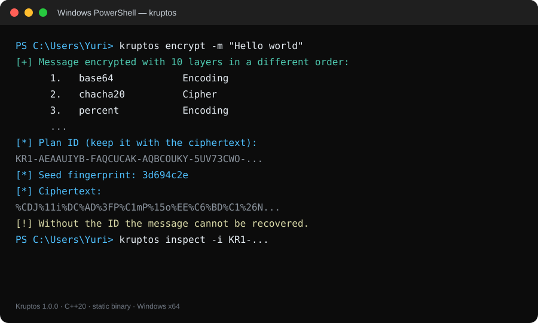
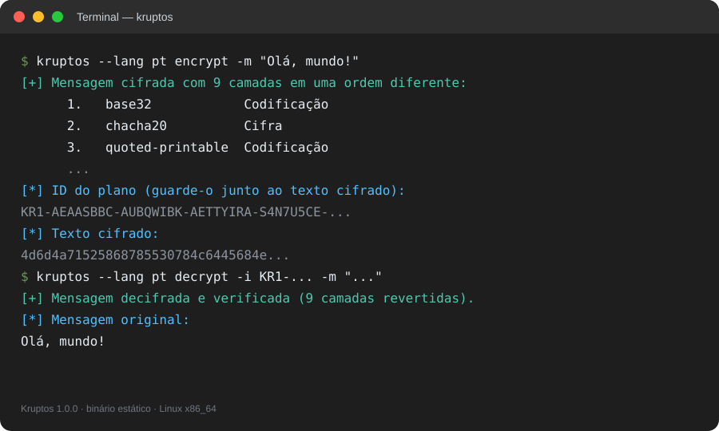

# Kruptos


**Kruptos** es un cifrador multicapa por línea de comandos que transforma un
mensaje de texto plano en un bloque cifrado mediante una cadena de 7 a 12 capas
de cifrado y codificación, elegidas y ordenadas para cada mensaje. Cada ejecución
produce un texto cifrado en ASCII imprimible y un ID `KR1-...` que registra el plan
exacto y la semilla necesaria para revertirlo.

Diseñado específicamente para desarrolladores, administradores de sistemas,
equipos de seguridad y usuarios técnicos que necesitan cifrar textos desde
PowerShell, CMD o una terminal Linux sin depender de servicios web, runtimes ni
instaladores pesados, *Kruptos* elimina el encadenamiento manual de utilidades y
lo reemplaza por un único comando portable y reproducible.

Con C++20, 26 métodos reversibles, un ID autodescriptivo, verificación de
integridad y binarios estáticos, el proyecto permite cifrar, descifrar e
inspeccionar mensajes en Windows y Linux sin instalar Visual C++ Redistributable,
.NET ni librerías de terceros.

> [!IMPORTANT]
> Sin contraseña, el ID contiene la semilla y la lista de capas: **quien tenga el
> ID puede descifrar**. Usa `-p` para proteger el plan con ChaCha20 + HMAC-SHA-256
> y PBKDF2. Kruptos es una herramienta de cifrado multicapa y ofuscación; no
> sustituye a GPG/age para comunicaciones de alto valor.

---

## 📑 Índice

1. [Capturas de pantalla](#-capturas-de-pantalla)
2. [Características principales](#-características-principales)
3. [¿Qué hace?](#-qué-hace-módulos-disponibles)
4. [Tecnologías utilizadas](#-tecnologías-utilizadas)
5. [Instalación y uso](#-instalación-y-uso)
6. [Cómo funciona](#-cómo-funciona)
7. [Repertorio de métodos](#-repertorio-de-métodos)
8. [Seguridad y modelo de amenaza](#-seguridad-y-modelo-de-amenaza)
9. [Pruebas y calidad](#-pruebas-y-calidad)
10. [Distribución y releases](#-distribución-y-releases)
11. [Estructura del proyecto](#-estructura-del-proyecto)
12. [Preguntas frecuentes](#-preguntas-frecuentes)
13. [Solución de problemas](#-solución-de-problemas)
14. [Roadmap](#-roadmap)
15. [Autor](#-autor)
16. [Licencia](#-licencia)

---

## 📸 Capturas de pantalla

Capturas de terminal (SVG) basadas en la salida real de Kruptos 1.0.0.
La aplicación es una CLI; no tiene interfaz gráfica ni versión móvil.

<div align="center">
  <table border="0">
    <thead>
      <tr>
        <th align="center">Windows · PowerShell</th>
        <th align="center">Linux · Terminal</th>
      </tr>
    </thead>
    <tbody>
      <tr>
        <td align="center" valign="middle">
          
        </td>
        <td align="center" valign="middle">
          
        </td>
      </tr>
    </tbody>
  </table>
</div>

---

## ✨ Características principales

* **Cifrado multicapa adaptativo:** en cada ejecución se aplican entre 7 y 12
  métodos distintos de un repertorio de 26, en un orden diferente, sin repetir
  ninguno dentro del mismo plan. La selección y el orden los decide el CSPRNG del
  sistema (`BCryptGenRandom` en Windows, `getrandom`/`/dev/urandom` en Linux).

* **ID autodescriptivo `KR1-...`:** el identificador contiene la lista de métodos,
  la semilla maestra de 32 bytes y una huella del texto cifrado. No hay base de
  datos, servidor ni estado local: el ID es portable entre máquinas y se puede
  mostrar con `kruptos inspect`.

* **Descifrado inverso con verificación real:** Kruptos revierte las capas en
  orden inverso, vuelve a aplicar el plan sobre el mensaje recuperado y compara la
  huella. Si el ID, el texto o la contraseña no coinciden, devuelve un error en
  lugar de un mensaje corrupto.

* **Contraseña opcional con autenticación:** `-p` protege el plan y la semilla con
  PBKDF2-HMAC-SHA256 (150 000 iteraciones), ChaCha20 y HMAC-SHA-256. El ID deja de
  ser suficiente para descifrar y una contraseña incorrecta o un ID manipulado se
  detectan por el MAC.

* **Portable y sin dependencias:** C++20 con CRT estática en Windows y enlace
  estático en Linux. El ejecutable Release no depende de `VCRUNTIME140.dll`,
  `MSVCP140.dll`, `ucrtbase.dll` ni de una versión concreta de libstdc++; se puede
  copiar y ejecutar sin instalar nada.

* **CLI completa y shell interactivo:** comandos al estilo Nmap (`encrypt`,
  `decrypt`, `inspect`, `methods`, `selftest`, `language`), opciones para mensaje,
  ID, archivos, salida, capas y contraseña, entrada por tubería, JSON, modo
  silencioso y un shell con prompts para uso manual.

* **Interfaz trilingüe y UTF-8:** español, inglés y portugués; detección del idioma
  del sistema, `--lang`, `KRUPTOS_LANG` y un selector numérico dentro del shell.
  Soporta acentos, emoji y rutas Unicode en Windows y Linux.

---

## ⚙️ ¿Qué hace? (Módulos disponibles)

Desde la lectura del mensaje hasta la verificación final, *Kruptos* implementa los
siguientes componentes:

1. **CLI, comandos y shell interactivo (`src/cli.cpp`):** parsea argumentos y
   opciones, resuelve el mensaje/ID desde `-m`, `-f` o stdin, ejecuta los comandos,
   gestiona JSON/modo silencioso, archivos de salida, prompts de contraseña,
   selector de idioma y el shell `kruptos>`.

2. **Internacionalización (`src/i18n.cpp`):** catálogo de 156 mensajes en español,
   inglés y portugués, detección del idioma del sistema, códigos `es`/`en`/`pt` y
   sustitución de placeholders para textos con valores dinámicos.

3. **Motor de capas (`src/pipeline.cpp`):** construye el plan, selecciona métodos
   aplicables, controla presupuestos de expansión, aplica y revierte las capas,
   calcula la huella del texto cifrado y valida la integridad al descifrar.

4. **Repertorio de métodos (`src/methods.cpp`, `src/encoding.cpp`):** 12 cifrados y
   14 codificaciones reversibles, con reglas de aplicabilidad, presupuesto de
   tamaño y decodificadores estrictos que detectan entradas mal formadas.

5. **Criptografía e identificadores (`src/crypto.cpp`, `src/token.cpp`):** SHA-256,
   HMAC-SHA-256, PBKDF2, ChaCha20, comparación en tiempo constante, serialización
   Base32 del ID, checksum, cifrado del plan y autenticación con contraseña.

6. **Entropía, terminal y pruebas (`src/rng.cpp`, `src/terminal.cpp`,
   `src/selftest.cpp`):** CSPRNG del sistema, derivación de claves por paso,
   consola UTF-8 con colores ANSI, lectura oculta de contraseña y 579 aserciones
   internas de vectores, round-trip, IDs e integridad.

---

## 🛠️ Tecnologías utilizadas

* **Lenguaje y compilación:** C++20 (`std::span`, `std::filesystem`,
  `std::optional`), CMake 3.20+, MSBuild/Visual Studio 2026 (toolset v145),
  GCC/Clang, CRT estática (`/MT`, `/MTd`), enlace `-static` en Linux y GitHub
  Actions.

* **Criptografía:** ChaCha20 (RFC 8439), SHA-256 (FIPS 180-4), HMAC-SHA-256
  (RFC 2104), PBKDF2-HMAC-SHA256 (RFC 8018), CSPRNG del sistema y comparación en
  tiempo constante.

* **Codificaciones:** Base16, Base32, Base64, Base64URL, Base58, Ascii85,
  percent-encoding, quoted-printable, binario, octal, decimal, escapes Unicode,
  entidades HTML y morse.

* **Plataformas y UX:** Windows x64/Win32, Linux x86_64/aarch64, PowerShell, CMD y
  Bash, consola UTF-8, colores ANSI, JSON, archivos, tuberías y una interfaz en tres
  idiomas.

---

## 🚀 Instalación y uso

Kruptos se distribuye como **ejecutable portable** en Windows y **binario estático**
en Linux. Esta versión no publica instaladores MSI/UAC ni paquetes `.deb`, `.rpm` o
`.AppImage`; el objetivo es un único archivo que se pueda copiar y ejecutar.

### Windows — Variante B: ejecutable portable

1. Descarga el paquete `Kruptos-windows-x64.zip` desde la sección
   [**Releases**](../../releases) y extrae su contenido.

2. Ejecuta una sola vez:

   ```powershell
   .\install.cmd
   ```

   El instalador portable copia `kruptos.exe` a
   `%LOCALAPPDATA%\Programs\Kruptos` y agrega esa carpeta al PATH del usuario.
   **No solicita administrador (UAC), no toca el PATH del sistema y no instala
   runtimes.**

3. Abre una **nueva** PowerShell y comprueba:

   ```powershell
   kruptos --help
   kruptos version
   kruptos encrypt -m "Hola mundo"
   ```

   Si no quieres abrir otra ventana, refresca el PATH en la sesión actual:

   ```powershell
   $env:Path = [Environment]::GetEnvironmentVariable('Path','Machine') + ';' + [Environment]::GetEnvironmentVariable('Path','User')
   kruptos --help
   ```

4. También puedes usarlo sin tocar el PATH:

   ```powershell
   .\kruptos.exe --help
   .\install.ps1 -NoPath
   & "$env:LOCALAPPDATA\Programs\Kruptos\kruptos.exe" --help
   ```

**Desinstalar:**

```powershell
.\install.ps1 -Uninstall
```

**Notas de Windows:**

- El `.exe` está compilado con CRT estática. Verificado con `dumpbin`: solo depende
  de `bcrypt.dll`, `SHELL32.dll` y `KERNEL32.dll`, todas del sistema.
- No requiere Visual C++ Redistributable, .NET, Python ni permisos elevados.
- El ejecutable no está firmado digitalmente. Si SmartScreen advierte, elige
  **Más información → Ejecutar de todas formas**.
- Para actualizar la copia instalada, vuelve a ejecutar `install.cmd`.

### Linux — Variante D adaptada: binario estático

1. Descarga `Kruptos-linux-<arch>.tar.gz` desde
   [**Releases**](../../releases) y extrae el paquete:

   ```bash
   mkdir -p Kruptos-linux
   tar -xzf Kruptos-linux-x86_64.tar.gz -C Kruptos-linux
   cd Kruptos-linux
   ```

2. Instala en tu directorio de usuario, sin `sudo`:

   ```bash
   chmod +x install.sh
   ./install.sh
   ```

   El instalador copia el binario a `~/.local/bin/kruptos`. Si esa carpeta no está
   en el PATH, muestra la línea `export PATH=...` que debes añadir a `~/.profile`,
   `~/.bashrc` o `~/.zshrc`.

3. Abre una terminal nueva y comprueba:

   ```bash
   kruptos --help
   kruptos version
   kruptos encrypt -m "Hola mundo"
   ```

4. Sin instalar:

   ```bash
   chmod +x kruptos
   ./kruptos --help
   ```

**Desinstalar:**

```bash
./install.sh --uninstall
```

**Notas de Linux:**

- El binario se enlaza con `-DKRUPTOS_STATIC=ON`: no necesita libstdc++/glibc
  instaladas en el equipo destino, solo el kernel de Linux de la misma arquitectura.
- No hay paquetes `.deb`, `.rpm` ni `.AppImage` en esta versión; el binario estático
  es el formato portable.
- En equipos ARM64, compila en esa arquitectura con `./build.sh --static` o usa el
  artefacto correspondiente.
- La compilación estática necesita las librerías estáticas del compilador
  (`libstdc++.a`, `libgcc.a`) **solo en la máquina que compila**.

### Compilar desde el código fuente

```bash
git clone https://github.com/TU-USUARIO/Kruptos-CLI.git
cd Kruptos-CLI
```

Sustituye `TU-USUARIO` por tu usuario de GitHub.

**Windows (Visual Studio 2026):**

```powershell
# Abre Kruptos.slnx y pulsa F5, o compila desde PowerShell:
.\build.ps1

# Paquete portable: dist\ + Kruptos-windows-x64.zip
.\publish.ps1
```

El proyecto usa el toolset `v145`, C++20, x64/Win32 y CRT estática. Enlaza
`bcrypt.lib` y `shell32.lib`.

**Linux (CMake + GCC/Clang):**

```bash
chmod +x build.sh install.sh publish-linux.sh
./build.sh              # binario dinámico
./build.sh --static     # binario autocontenido
./publish-linux.sh      # dist/linux-<arch>/ + Kruptos-linux-<arch>.tar.gz
```

También:

```bash
cmake -S . -B build -DCMAKE_BUILD_TYPE=Release -DKRUPTOS_STATIC=ON
cmake --build build --parallel
ctest --test-dir build --output-on-failure
```

**CI:** `.github/workflows/build.yml` compila y prueba Windows x64 y Linux x86_64,
y publica los artefactos `Kruptos-windows-x64.zip` y
`Kruptos-linux-x86_64.tar.gz`.

### Verificar la instalación

```powershell
kruptos version      # versión, motor y métodos
kruptos selftest     # 579 pruebas internas
kruptos methods      # repertorio completo
```

En Linux, `ldd "$(command -v kruptos)"` debe indicar `not a dynamic executable` (o
similar) si el binario es estático. En Windows, `dumpbin /dependents kruptos.exe`
debe mostrar solo DLLs del sistema.

### Opciones de la CLI

| Opción | Descripción |
| --- | --- |
| `-m, --message <texto>` | Mensaje o texto cifrado. Si se omite, se pide por consola o se lee de stdin. |
| `-i, --id <ID>` | Identificador `KR1-...` necesario para descifrar e inspeccionar. |
| `-f, --file <ruta>` | Lee el mensaje de un archivo UTF-8 (elimina un salto de línea final). |
| `-o, --output <ruta>` | Guarda el resultado en un archivo (cifrado o mensaje). |
| `-l, --layers <n>` | Fuerza el número de capas (1-16). |
| `-p, --password` | Pide una contraseña oculta para proteger el ID. |
| `--passphrase <texto>` | Contraseña en la línea de comandos (menos segura, para scripts). |
| `-L, --lang <idioma>` | Idioma de la interfaz: `es`, `en` o `pt`. |
| `-v, --verbose` | Muestra el detalle de las capas al descifrar. |
| `-j, --json` | Salida JSON para automatización. |
| `-q, --quiet` | Solo el resultado. |
| `--no-color` | Desactiva los colores ANSI. |
| `-h, --help` | Ayuda completa (incluye créditos). |
| `-V, --version` | Versión. |

### Primeros comandos

```powershell
# Cifrar pidiendo el mensaje por consola
kruptos encrypt

# Cifrar un mensaje y forzar 10 capas
kruptos encrypt -m "Reunión a las 19:30 en el café" -l 10

# Descifrar con el ID y el texto que devolvió el comando anterior
kruptos decrypt -i "KR1-..." -m "..."

# Ver el plan de capas de un ID
kruptos inspect -i "KR1-..."

# Listar los 26 métodos
kruptos methods

# Cambiar el idioma
kruptos language
```

### Ejemplos detallados

**1. Cifrado y descifrado básico**

```powershell
$salida = kruptos encrypt -m "Hola mundo" -q
$id     = $salida[0]
$cifra  = $salida[1]

kruptos decrypt -i $id -m $cifra -q
# Hola mundo
```

**2. ID protegido con contraseña**

```powershell
kruptos encrypt -m "Secreto" -p
# Pide la contraseña dos veces y muestra el ID + texto cifrado

kruptos decrypt -i "KR1-..." -m "..." 
# Pide la contraseña si el ID está protegido
```

En scripts:

```powershell
kruptos encrypt -m "Secreto" --passphrase "una-clave-larga" -q
kruptos decrypt -i "KR1-..." -m "..." --passphrase "una-clave-larga" -q
```

**3. Archivos y tuberías**

```powershell
Get-Content .\mensaje.txt | kruptos encrypt -o .\cifrado.txt
kruptos decrypt -f .\cifrado.txt -i "KR1-..." -o .\original.txt
```

```bash
cat mensaje.txt | kruptos encrypt -o cifrado.txt
kruptos decrypt -f cifrado.txt -i "KR1-..." -o original.txt
```

**4. Automatización con JSON**

```powershell
$resultado = kruptos encrypt -m "Hola" -j | ConvertFrom-Json
$resultado.id
$resultado.layers
$resultado.methods

kruptos decrypt -i $resultado.id -m $resultado.ciphertext -j | ConvertFrom-Json
```

**5. Modo silencioso**

```text
kruptos encrypt -m "Hola" -q
<ID en la primera línea>
<texto cifrado en la segunda línea>

kruptos decrypt -i <ID> -m <texto> -q
Hola
```

**6. Inspección y detalle**

```powershell
kruptos inspect -i "KR1-..." -v
kruptos decrypt -i "KR1-..." -m "..." -v
```

### Modo interactivo

Sin argumentos se abre un shell:

```text
$ kruptos
  _  __                 _
 | |/ /_ __ _   _ _ __ | |_ ___  ___
 | ' /| '__| | | | '_ \| __/ _ \/ __|
 | . \| |  | |_| | |_) | || (_) \__ \
 |_|\_\_|   \__,_| .__/  \__\___/|___/
                 |_|
  Cifrado multicapa adaptativo  ·  v1.0.0

[*] Modo interactivo. Escribe 'help' para ver los comandos, 'language' para
    cambiar el idioma y 'exit' para salir.

kruptos> encrypt
kruptos> decrypt
kruptos> inspect -i KR1-...
kruptos> methods
kruptos> language
kruptos> exit
```

El shell admite comillas simples y dobles, rutas con espacios y el comando
`language` con selector numérico.

### Idiomas

Orden de detección:

1. `--lang` / `-L` de la ejecución.
2. Variable de entorno `KRUPTOS_LANG`.
3. Idioma del sistema (Windows UI o `LC_ALL` / `LC_MESSAGES` / `LANG`).
4. Inglés si no se reconoce.

El selector del comando `language` muestra:

```text
1. English
2. Español
3. Português
```

El cambio afecta a la ejecución/sesión actual. Para fijarlo:

```powershell
$env:KRUPTOS_LANG = "es"
```

```bash
export KRUPTOS_LANG=pt
```

O en cada comando:

```powershell
kruptos --lang en --help
kruptos -L pt version
```

### Solución rápida de problemas de uso

| Síntoma | Solución |
| --- | --- |
| `kruptos` no se reconoce | Abre una PowerShell nueva o refresca el PATH; comprueba `Get-Command kruptos`. |
| La política de ejecución bloquea `.ps1` | Usa `install.cmd` (aplica `-ExecutionPolicy Bypass` solo a su proceso) o `powershell -ExecutionPolicy Bypass -File .\install.ps1`. |
| SmartScreen advierte | El ejecutable no está firmado; usa “Más información → Ejecutar de todas formas”. |
| `kruptos` abre una versión antigua | Reinstala con `install.cmd`; `Get-Command kruptos` muestra la ruta. |
| No aparece el ID | El ID se imprime antes del texto cifrado; en modo `-q` es la primera línea. |
| “Verificación de integridad fallida” | El texto cifrado no corresponde al ID o está incompleto; vuelve a copiarlo entero. |
| “Contraseña incorrecta o ID alterado” | Revisa la contraseña/ID; el MAC protege el plan. |
| Falta el ID | Sin el ID no se puede descifrar; no hay recuperación. |
| Mensaje largo en Windows | La línea de comandos ronda los 32 KB; usa `-f` o stdin en lugar de `-m`. |
| Colores raros en la terminal | Usa `--no-color` o define `NO_COLOR=1`. |
| Linux no encuentra `kruptos` | Añade `~/.local/bin` al PATH o ejecuta `./kruptos` directamente. |

---

## 🔐 Cómo funciona

### Flujo de una operación

```text
Mensaje de texto
      │
      ▼
[ capa 1 ] → [ capa 2 ] → [ capa 3 ] → ... → [ capa N ]
      │
      ▼
Texto cifrado (ASCII imprimible, sin espacios)
      │
      ├── ID KR1: versión + métodos + semilla + huella
      │
      ▼
Descifrado: N → ... → 3 → 2 → 1 → verificación
```

1. El mensaje se lee desde `-m`, `-f`, stdin o el prompt.
2. El motor elige entre 7 y 12 métodos distintos y los ordena con el CSPRNG.
3. Cada capa transforma el resultado de la anterior.
4. La última capa es siempre una codificación compacta (sin espacios), para que el
   texto se pueda copiar y pegar.
5. Se construye el ID con el plan, la semilla de 32 bytes y una huella del texto.
6. Al descifrar se revierte el plan y se vuelve a cifrar para verificar la huella.

### Selección y orden de capas

- Repertorio de 26 métodos: 12 cifrados y 14 codificaciones.
- Por defecto se aplican entre 7 y 12 métodos, sin repetir ninguno.
- `-l 1..16` fuerza un número exacto (con reintentos para encontrar un plan viable).
- El motor descarta métodos no aplicables (por ejemplo, morse con bytes no
  representables o base58 con buffers grandes).
- Se aplica un presupuesto de expansión para que una cadena de codificaciones no
  convierta un mensaje corto en megabytes: base de 4 KB / 32× el mensaje, con topes
  por paso y por resultado final.
- Si la selección no puede completar el objetivo, el modo libre acepta una cadena
  algo más corta; el modo `-l` avisa con un error claro.

### Derivación de material clave

La semilla maestra (32 bytes) se genera con el CSPRNG. Cada capa deriva sus
parámetros con:

```text
HMAC-SHA256(semilla, "Kruptos/keystream/v1" || paso || método || contador)
```

Así, el ID no necesita guardar una clave por capa: basta la semilla y el plan. Los
cifrados que necesitan clave/nonce, longitud de clave, desplazamiento o número de
rieles obtienen esos valores del flujo derivado, de forma determinista, tanto al
cifrar como al descifrar.

### El ID KR1

```text
KR1-<Base32 del payload, grupos de 8 caracteres separados por ->
```

El ID es autocontenido y portable. Se acepta en mayúsculas o minúsculas, con o sin
guiones, y se ignoran espacios/saltos de línea. `inspect` muestra la versión,
protección, número de capas, huella de la semilla y orden de aplicación.

### Verificación de integridad

Después de revertir todas las capas, Kruptos vuelve a aplicar el plan al mensaje
recuperado y compara el fingerprint almacenado en el ID. Esto detecta:

- un texto cifrado alterado o incompleto;
- un ID que no corresponde a ese texto;
- una contraseña incorrecta (además del MAC);
- corrupción durante la copia/pegado.

La comprobación es de 32 bits (truncado de SHA-256) para el fingerprint del texto;
el checksum/MAC del ID protege la estructura del plan. En modo sin contraseña, el
checksum detecta errores accidentales, pero no es una firma: un atacante puede
recalcularlo. En modo con contraseña, el MAC autentica el plan.

### Protección con contraseña

Con `-p` o `--passphrase`:

- Se genera una sal de 16 bytes y un nonce de 12 bytes.
- PBKDF2-HMAC-SHA256 con 150 000 iteraciones deriva 64 bytes: 32 para ChaCha20 y 32
  para HMAC.
- El plan+semilla se cifra con ChaCha20.
- Se autentica con HMAC-SHA256 truncado a 16 bytes.
- Una contraseña incorrecta o un ID manipulado fallan antes de descifrar.

### Formato binario del ID

**Sin contraseña (`flags = 0`):**

| Campo | Tamaño |
| --- | --- |
| versión | 1 byte (`1`) |
| flags | 1 byte |
| número de capas | 1 byte |
| IDs de método, en orden | *n* bytes |
| semilla maestra | 32 bytes |
| huella del texto cifrado | 4 bytes |
| SHA-256 del payload anterior (primeros 4 bytes) | 4 bytes |

**Con contraseña (`flags = 1`):**

| Campo | Tamaño |
| --- | --- |
| versión + flags | 2 bytes |
| sal PBKDF2 | 16 bytes |
| nonce ChaCha20 | 12 bytes |
| plan cifrado (ChaCha20) | variable |
| HMAC-SHA-256 truncado | 16 bytes |

Todo el payload se serializa en Base32 y se agrupa en bloques de 8 caracteres para
facilitar la copia.

### Límites y rendimiento

| Límite | Valor |
| --- | --- |
| Mensaje máximo | 128 KB |
| Capas por plan | 1-16 (`-l`), 7-12 por defecto |
| Texto cifrado máximo | 16 MB |
| Línea de comandos en Windows | ~32 KB; usa archivos/stdin para mensajes grandes |
| Base58 | Solo buffers ≤ 4096 bytes (aritmética O(n²)) |
| Morse | Solo caracteres representables en su tabla |
| Salida final | ASCII imprimible sin espacios |

En un equipo moderno, un mensaje de 100 KB se cifra/descifra en décimas de segundo
(el tamaño y el tiempo dependen del plan). Todo el mensaje se procesa en memoria.

---

## 🧩 Repertorio de métodos

Kruptos aplica cada método como máximo una vez por plan. Los identificadores son
estables y forman parte del formato del ID: **no los renumeres** si añades métodos.

### Cifrados (12)

| ID | Método | Descripción |
| ---: | --- | --- |
| 1 | `chacha20` | Flujo ChaCha20 (RFC 8439) con clave y nonce generados. |
| 2 | `rc4` | Flujo RC4 con clave generada (capa heredada de ruido). |
| 3 | `sha256-ctr` | Flujo XOR derivado de SHA-256 en modo contador. |
| 4 | `caesar` | Desplazamiento aditivo de cada byte módulo 256. |
| 5 | `vigenere` | Suma módulo 256 con clave repetida. |
| 6 | `atbash` | Complemento a 255 de cada byte. |
| 7 | `rot13` | Rotación de 13 posiciones en letras A-Z/a-z. |
| 8 | `rot47` | Rotación de 47 posiciones en ASCII imprimible (33-126). |
| 9 | `reverse` | Inversión completa del orden de los bytes. |
| 10 | `bit-rotate` | Rotación de bits dentro de cada byte. |
| 11 | `nibble-swap` | Intercambio de los dos nibbles de cada byte. |
| 12 | `rail-fence` | Transposición en zigzag con 2-6 rieles. |

### Codificaciones (14)

| ID | Método | Descripción |
| ---: | --- | --- |
| 32 | `base64` | Base64 estándar con relleno (RFC 4648). |
| 33 | `base64url` | Base64 variante URL sin relleno. |
| 34 | `base32` | Base32 RFC 4648 sin relleno. |
| 35 | `base16` | Hexadecimal en minúsculas. |
| 36 | `base58` | Base58 estilo Bitcoin (buffers ≤ 4096 bytes). |
| 37 | `base85` | Ascii85 delimitado con `<~ ~>`. |
| 38 | `percent` | Codificación porcentual de URL (`%XX`). |
| 39 | `quoted-printable` | Quoted-printable sin saltos de línea. |
| 40 | `binary` | Bits de cada byte separados por espacios. |
| 41 | `octal` | Valores octal de 3 dígitos separados por espacios. |
| 42 | `decimal` | Valores decimales 0-255 separados por espacios. |
| 43 | `unicode-escape` | Secuencias `\u00XX` por byte. |
| 44 | `html-entities` | Entidades numéricas `&#NNN;` por byte. |
| 45 | `morse` | Código morse (marca `*` para minúsculas; `/` para espacio). |

**Reglas del motor:**

- Los métodos de decodificación son estrictos: una entrada mal formada produce un
  error, no un mensaje silencioso.
- La última capa es una codificación compacta para que el texto cifrado no tenga
  espacios ni caracteres de control.
- Las capas que expanden demasiado se omiten según el presupuesto.
- `base58` se reserva para buffers pequeños por su complejidad cuadrática.
- `morse` solo se aplica si todos los bytes están en su tabla.
- Los identificadores de método no deben cambiar entre versiones.

---

## 🔐 Seguridad y modelo de amenaza

Kruptos combina primitivas modernas con capas de codificación y transformaciones
clásicas. La seguridad depende del modo de uso; conviene ser explícito sobre el
modelo.

### Sin contraseña

- El ID contiene la semilla de 32 bytes y la lista de capas. **Quien tenga el ID
  puede descifrar.**
- El texto cifrado por sí solo no revela el plan ni la semilla; sin el ID hay que
  descubrir la combinación y el orden de capas, además de la semilla.
- Las capas aportan difusión y oscurecimiento; no son un secreto de clave.
- El checksum de 4 bytes detecta errores accidentales, pero **no autentica** el ID:
  un atacante puede modificarlo y recalcularlo.
- Envía el ID y el texto cifrado por canales distintos si no usas contraseña.

### Con contraseña (`-p`)

- El plan y la semilla se cifran con ChaCha20 y se autentican con HMAC-SHA-256.
- PBKDF2-HMAC-SHA256 (150 000 iteraciones) deriva 64 bytes de la contraseña.
- Una contraseña incorrecta o un ID manipulado fallan por el MAC.
- El ID por sí solo no permite descifrar; la contraseña es imprescindible.
- Usa una contraseña larga y única; no la reutilices.

### Qué protege y qué no

| Escenario | Sin contraseña | Con contraseña |
| --- | --- | --- |
| Confidencialidad si el atacante no tiene el ID | Sí | Sí |
| Confidencialidad si el atacante tiene el ID | No | Sí, sin la contraseña |
| Detección de corrupción accidental | Checksum de 4 bytes | MAC de 16 bytes |
| Autenticidad del plan frente a un atacante activo | No | Sí (MAC) |
| Recuperación si se pierde el ID | No | No |
| Recuperación si se olvida la contraseña | N/A | No |

### Buenas prácticas

1. Usa `-p` si el ID viaja junto al texto o si necesitas confidencialidad real.
2. Guarda una copia del ID; sin él no hay recuperación.
3. Prueba el descifrado antes de borrar el mensaje original.
4. No publiques ID y texto cifrado en el mismo canal sin contraseña.
5. Usa `--passphrase` solo en entornos controlados: puede quedar en el historial y
   en la lista de procesos.
6. Para secretos de alto valor, usa GPG/age, un gestor de secretos o un protocolo
   con clave pública y forward secrecy.
7. Verifica la procedencia del binario (hash/firma) cuando esté disponible.
8. Mantén actualizado el binario y revisa los cambios de seguridad.

### Lo que Kruptos no hace

- No implementa intercambio de claves ni forward secrecy.
- No oculta metadatos (tamaño, hora, nombre de archivo, etc.).
- No borra de forma segura el mensaje original ni la memoria del proceso.
- No protege contra un equipo comprometido, keyloggers o malware.
- No sustituye una auditoría de seguridad ni un protocolo de mensajería seguro.
- No es una herramienta de esteganografía.

### Auditoría

Kruptos no ha sido auditado por terceros. El código y las pruebas están disponibles
para revisión; si lo usas en producción, haz tu propia evaluación.

---

## 🧪 Pruebas y calidad

### Ejecutar las pruebas

```powershell
kruptos selftest          # resumen
kruptos selftest -v       # detalle de cada aserción
```

```bash
kruptos selftest -v
```

### Cobertura actual

- Vectores conocidos de SHA-256, HMAC-SHA-256, PBKDF2 y ChaCha20 (RFC 8439).
- Round-trip de los 26 métodos con datos binarios, Unicode y variados.
- Pruebas de formato inválido en Base64, Base16, binario y quoted-printable.
- Serialización/reversión de IDs, IDs alterados, IDs truncados y contraseñas.
- Cifrado/descifrado completo con planes de 7-12 capas, verificación de integridad,
  determinismo del plan y detección de texto alterado.
- Repertorio: IDs y nombres únicos, métodos resolubles.

Actualmente son **579 aserciones**. El comando `selftest` las ejecuta en el idioma
activo; los detalles técnicos de cada aserción se muestran en inglés.

### Integración continua

`.github/workflows/build.yml` compila y prueba:

- Windows x64 con CMake/MSVC y CRT estática.
- Linux x86_64 con enlace `-static`.
- Publica los ZIP/TAR de distribución como artefactos.

### Nota de honestidad

Kruptos no ha sido auditado por terceros ni sometido a un programa formal de
fuzzing. Las pruebas internas cubren vectores, round-trip y casos de error, pero no
garantizan ausencia de fallos. Revisa el código y el modelo de seguridad antes de
usarlo para proteger información crítica.

---

## 📦 Distribución y releases

### Windows

```powershell
.\publish.ps1                 # x64
.\publish.ps1 -Platform Win32 # x86
```

Genera:

- `dist\kruptos.exe` (autocontenido).
- `dist\install.cmd`, `dist\install.ps1`, `dist\LEEME.txt`, `dist\LEEME.md`.
- `Kruptos-windows-x64.zip` (o `-Win32`).

### Linux

```bash
./publish-linux.sh
```

Genera:

- `dist/linux-<arch>/kruptos` (estático).
- `dist/linux-<arch>/install.sh`.
- `dist/linux-<arch>/LEEME.txt`.
- `Kruptos-linux-<arch>.tar.gz`.

### Qué contiene cada paquete

| Paquete | Contenido | Instalación |
| --- | --- | --- |
| `Kruptos-windows-x64.zip` | `kruptos.exe`, `install.cmd`, `install.ps1`, LEEME | `install.cmd` (usuario, sin admin) |
| `Kruptos-linux-x86_64.tar.gz` | `kruptos`, `install.sh`, LEEME | `./install.sh` (usuario, sin root) |

### Verificar que es estático

```powershell
dumpbin /dependents .\dist\kruptos.exe
# Solo bcrypt.dll, SHELL32.dll, KERNEL32.dll
```

```bash
ldd ./dist/kruptos
# not a dynamic executable
```

---

## 🗂️ Estructura del proyecto

```text
.
├── .github/
│   └── workflows/
│       └── build.yml              CI Windows + Linux
├── docs/
│   ├── windows-powershell.svg     Captura de terminal Windows
│   └── linux-terminal.svg         Captura de terminal Linux
├── src/
│   ├── main.cpp                   Entrada (UTF-16 -> UTF-8 en Windows)
│   ├── cli.cpp/.h                 Comandos, opciones, shell, JSON
│   ├── i18n.cpp/.h                Textos es/en/pt y selector
│   ├── pipeline.cpp/.h            Plan, cifrado/descifrado, verificación
│   ├── methods.cpp/.h             Repertorio de 26 métodos
│   ├── encoding.cpp/.h            Codificaciones reversibles
│   ├── token.cpp/.h               ID KR1, checksum, protección
│   ├── crypto.cpp/.h              SHA-256, HMAC, PBKDF2, ChaCha20
│   ├── rng.cpp/.h                 CSPRNG y derivación por paso
│   ├── terminal.cpp/.h            Consola UTF-8, colores, contraseñas
│   ├── common.cpp/.h              Tipos y utilidades
│   └── selftest.cpp/.h            579 pruebas internas
├── Kruptos.slnx / Kruptos.vcxproj Proyecto Visual Studio 2026
├── CMakeLists.txt                 Build multiplataforma (CMake)
├── build.ps1 / build.sh           Compilación
├── install.ps1 / install.cmd      Instalador portable Windows
├── install.sh                     Instalador portable Linux
├── publish.ps1 / publish-linux.sh Paquetes portables
└── README.md
```

Generados y no versionados: `bin/`, `obj/`, `dist/`, `build/`, `build-static/`,
`Kruptos-windows-*.zip`, `Kruptos-linux-*.tar.gz`.

---

## ❓ Preguntas frecuentes

### ¿Kruptos reemplaza a GPG o age?

No. Kruptos es una herramienta de cifrado multicapa y ofuscación con un modelo
simétrico simple (el ID contiene la semilla si no usas contraseña). Para
comunicaciones de alto valor, usa GPG/age o un protocolo con clave pública y
forward secrecy.

### ¿Envía datos a Internet?

No. Kruptos no contiene código de red, telemetría ni actualizaciones automáticas.
Todo se ejecuta localmente.

### ¿El ID es secreto?

Sin contraseña, **sí**: contiene la semilla y el plan. Con `-p`, el plan y la
semilla van cifrados y autenticados; el ID por sí solo no permite descifrar.

### ¿Puedo reutilizar el mismo ID?

Cada cifrado crea un plan y un ID nuevos. El ID incluye la huella de ese texto
cifrado; si lo usas con otro texto, la verificación fallará. Puedes descifrar el
mismo texto varias veces con el mismo ID.

### ¿Qué pasa si pierdo el ID?

No hay recuperación. El ID es la única forma de reconstruir el plan y la semilla
(sin contraseña) o de abrir el plan (con contraseña).

### ¿Puedo elegir cuántas capas se aplican?

Sí: `-l 1..16`. Sin `-l`, se eligen entre 7 y 12 métodos distintos.

### ¿Necesito permisos de administrador?

No. El instalador de Windows copia a `%LOCALAPPDATA%` y modifica solo el PATH del
usuario. El de Linux copia a `~/.local/bin`. Puedes ejecutar el binario directamente
sin instalar.

### ¿Necesito .NET, Python o Visual C++ Redistributable?

No. Windows usa CRT estática y Linux enlace estático; no hay dependencias de
runtime para el usuario final.

### ¿Funciona en Windows 7?

La versión recomendada es Windows 10/11. No se ha validado Windows 7; el binario
usa APIs modernas del sistema y `bcrypt.dll`.

### ¿Funciona en ARM64?

El binario Linux puede compilarse en ARM64 con `./build.sh --static`. En Windows
ARM64, el ejecutable x64 funciona bajo emulación; no se publica un binario ARM64
nativo en esta versión.

### ¿Por qué hay 26 métodos?

El repertorio mezcla cifrados reales (ChaCha20, SHA-256-CTR, RC4), transformaciones
clásicas y codificaciones. El objetivo es la diversidad de capas y el
oscurecimiento; ChaCha20 y la contraseña aportan la parte criptográfica fuerte.

### ¿Puedo añadir métodos?

Sí. Añade una entrada en `methods()` con un ID nuevo (no reutilices IDs), implementa
`forward`/`inverse` y `applies`, y añade pruebas de round-trip. Mantén la
compatibilidad de los IDs existentes.

### ¿Dónde están los créditos?

En la salida de `kruptos --help`, en la sección **CRÉDITOS / CREDITS** de los tres
idiomas. El banner y `version` no los muestran.

### ¿La interfaz está en español?

Sí, y también en inglés y portugués. Usa `--lang es|en|pt`, `KRUPTOS_LANG` o el
comando `language` dentro del shell.

---

## 🛠️ Solución de problemas

### Windows

- **`kruptos` no se reconoce:** abre una PowerShell nueva; el PATH del usuario se
  actualiza al iniciar sesión. Para la sesión actual:

  ```powershell
  $env:Path = [Environment]::GetEnvironmentVariable('Path','Machine') + ';' + [Environment]::GetEnvironmentVariable('Path','User')
  ```

- **La política de ejecución bloquea `install.ps1`:** ejecuta `install.cmd`, que
  usa `-ExecutionPolicy Bypass` solo para ese proceso. También:

  ```powershell
  powershell -NoProfile -ExecutionPolicy Bypass -File .\install.ps1
  ```

- **SmartScreen:** el `.exe` no está firmado. “Más información → Ejecutar de todas
  formas”.

- **`kruptos` resuelve a una copia antigua:** `Get-Command kruptos` muestra la ruta;
  reinstala con `install.cmd` y verifica con `kruptos version`.

- **Mensaje demasiado largo:** usa `-f`/`-o` o una tubería; la línea de comandos de
  Windows tiene un límite práctico de ~32 KB.

### Linux

- **`Permission denied` al ejecutar `install.sh` o `kruptos`:**

  ```bash
  chmod +x install.sh kruptos
  ```

- **`kruptos: command not found`:** añade `~/.local/bin` al PATH:

  ```bash
  echo 'export PATH="$HOME/.local/bin:$PATH"' >> ~/.profile
  ```

  Abre una terminal nueva o recarga el perfil.

- **El binario no arranca:** comprueba la arquitectura (`uname -m`) y que el paquete
  corresponda; el binario estático es específico de la arquitectura.

- **La compilación `--static` falla:** faltan las librerías estáticas del compilador
  (`libstdc++.a`, `libgcc.a`). Instálalas solo en la máquina de compilación; el
  binario resultante no las necesita en el destino.

### Errores de Kruptos

- **“ID inválido” / checksum:** el ID está incompleto o mal copiado. Se aceptan
  minúsculas y espacios, pero no caracteres que no pertenezcan a Base32.
- **“No se pudo revertir la capa N”:** el texto no corresponde a ese ID o está
  corrupto. Copia el texto cifrado completo; no añadas caracteres.
- **“Contraseña incorrecta o ID alterado”:** revisa la contraseña; el MAC protege el
  plan.
- **“Verificación de integridad fallida”:** el texto se modificó o no es el que
  generó ese ID.
- **“Falta el ID”:** en modo no interactivo, pasa `-i`; no se puede pedir por consola
  si stdin está ocupado por una tubería.
- **“No hay consola interactiva para pedir la contraseña”:** usa `--passphrase` en
  scripts.

---

## 🗺️ Roadmap

- Firmar digitalmente los binarios de Windows y Linux.
- Publicar paquetes `.deb`, `.rpm` y `.AppImage` además del TAR estático.
- Binario nativo ARM64 para Windows.
- Fuzzing formal de decodificadores e IDs.
- Auditoría de seguridad externa.
- Completions para PowerShell/Bash y página `man`.
- Endurecimiento opcional de memoria (bloqueo/zeroización).
- Builds reproducibles y verificación de artefactos.
- Más métodos y un registro extensible sin romper IDs existentes.

Las ideas del roadmap no son compromisos de entrega; prioriza según el uso real.

---

## 👨‍💻 Autor

Desarrollado por **Yuri Alexander Pagel Krüger**.

Proyecto: **Kruptos** · Repositorio sugerido: **Kruptos-CLI**.

Enfoque: criptografía aplicada, herramientas de línea de comandos y portabilidad
sin dependencias.

---

## 📄 Licencia

Uso libre para fines educativos y personales. El software se proporciona **“tal
cual”**, sin garantías de ningún tipo.

Este repositorio no incluye todavía un archivo `LICENSE`. Si vas a publicarlo,
añade la licencia que prefieras (MIT, Apache-2.0, GPL-3.0, etc.) y actualiza esta
sección. Hasta entonces, no se conceden derechos implícitos más allá de los que
permita la ley aplicable.
