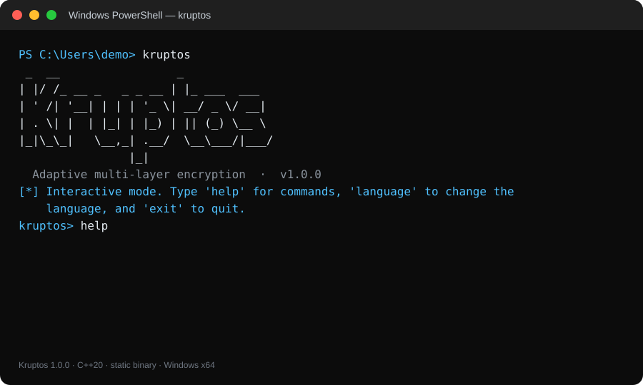
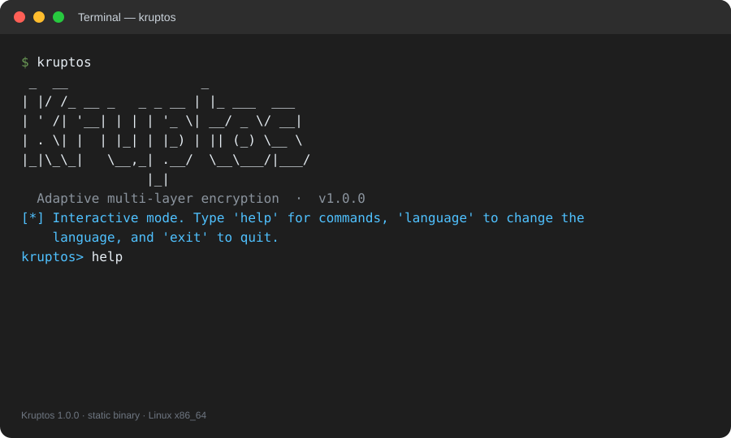
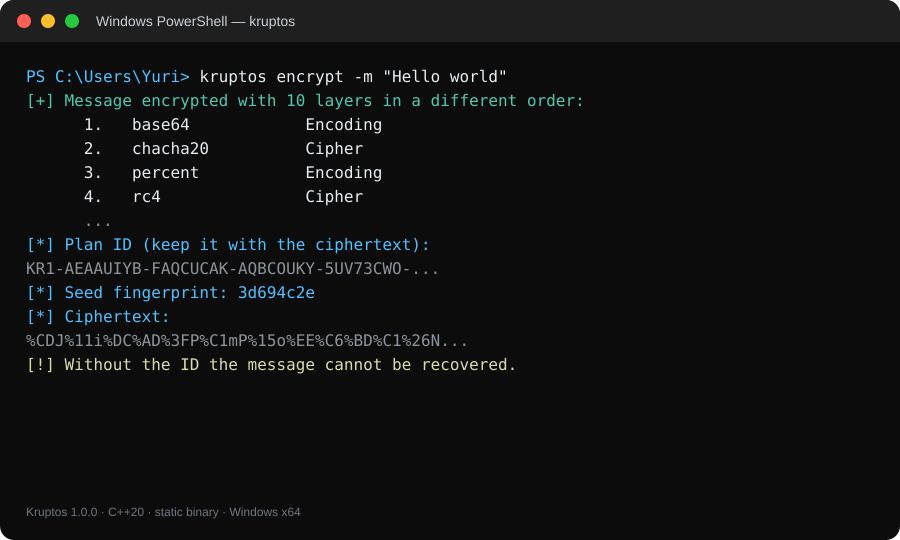
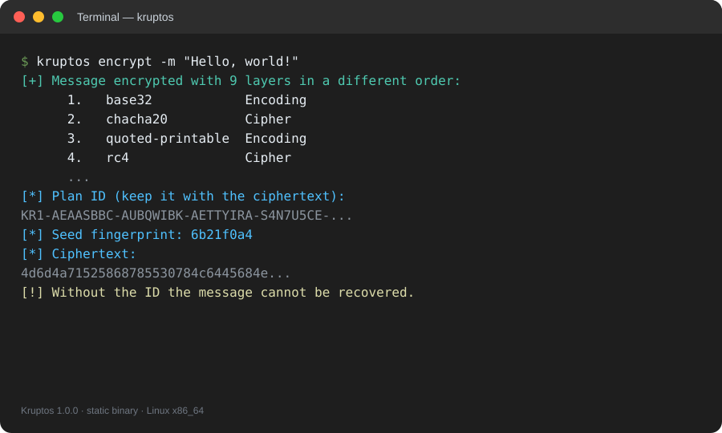
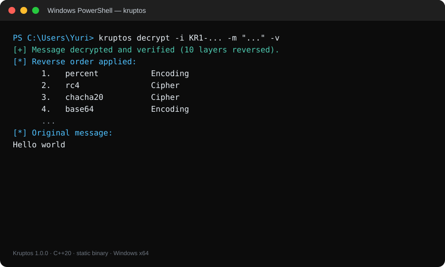
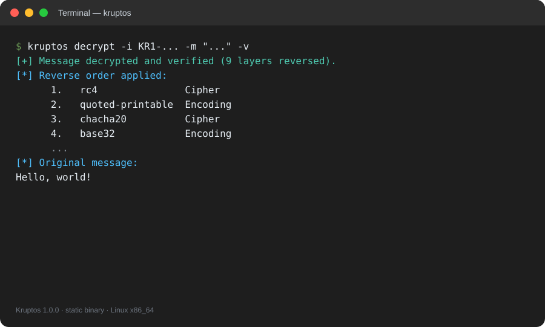
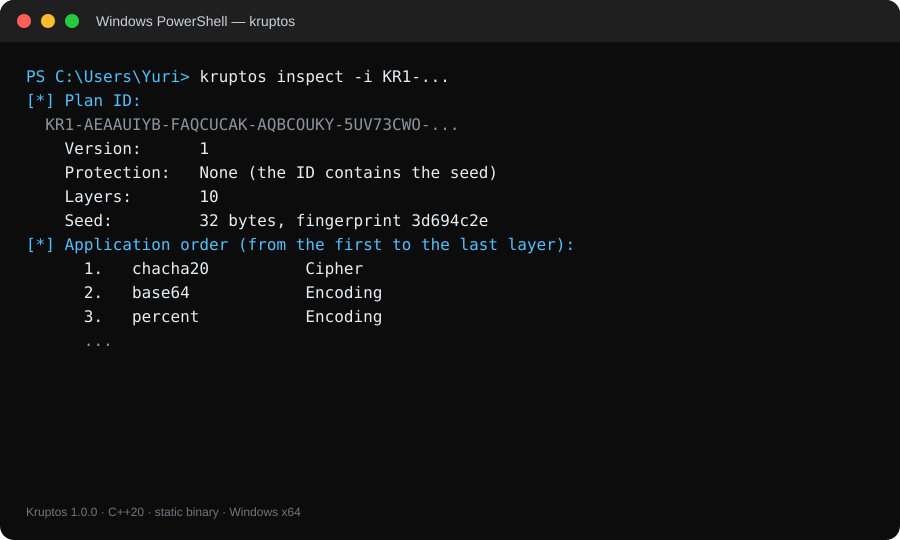
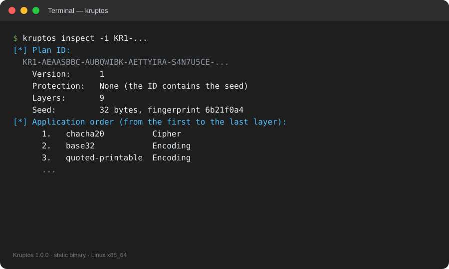

# Kruptos


**Kruptos** is a multi-layer command-line encryptor that turns plaintext into a
ciphertext through a chain of 7 to 12 encryption and encoding layers, selected and
ordered for each message. Every run produces printable ASCII ciphertext and a
`KR1-...` ID that records the exact plan and the seed required to reverse it.

Designed specifically for developers, system administrators, security teams, and
technical users who need to encrypt text from PowerShell, CMD, or a Linux terminal
without relying on web services, runtimes, or heavyweight installers, *Kruptos*
replaces manual tool chaining with a single portable and reproducible command.

With C++20, 26 reversible methods, a self-describing ID, integrity verification,
and static binaries, the project lets you encrypt, decrypt, and inspect messages on
Windows and Linux without installing the Visual C++ Redistributable, .NET, or any
third-party libraries.

> [!IMPORTANT]
> Without a password, the ID contains the seed and the layer plan: **anyone with
> the ID can decrypt**. Use `-p` to protect the plan with ChaCha20 + HMAC-SHA-256
> and PBKDF2. Kruptos is a multi-layer encryption and obfuscation tool; it is not a
> replacement for GPG/age for high-value communications.

---

## 📑 Table of Contents

1. [Screenshots](#-screenshots)
2. [Key Features](#-key-features)
3. [What It Does (Modules)](#-what-it-does-modules)
4. [Technologies](#-technologies)
5. [Installation and Usage](#-installation-and-usage)
6. [How It Works](#-how-it-works)
7. [Method Repertoire](#-method-repertoire)
8. [Security and Threat Model](#-security-and-threat-model)
9. [Tests and Quality](#-tests-and-quality)
10. [Distribution and Releases](#-distribution-and-releases)
11. [Project Structure](#-project-structure)
12. [FAQ](#-faq)
13. [Troubleshooting](#-troubleshooting)
14. [Roadmap](#-roadmap)
15. [Author](#-author)
16. [License](#-license)

---

## 📸 Screenshots

Eight terminal captures (SVG) from the English UI of Kruptos 1.0.0, paired by task
for Windows and Linux. Click any image to open the full-size capture. Kruptos is a
CLI; it has no graphical interface and no mobile version.

<div align="center">
  <table border="0">
    <thead>
      <tr>
        <th align="center">Windows · PowerShell</th>
        <th align="center">Linux · Terminal</th>
      </tr>
    </thead>
    <tbody>
      <tr>
        <td align="center" valign="middle">
          <a href="docs/windows-1-start.svg"></a><br />
          <sub>Start screen</sub>
        </td>
        <td align="center" valign="middle">
          <a href="docs/linux-1-start.svg"></a><br />
          <sub>Start screen</sub>
        </td>
      </tr>
      <tr>
        <td align="center" valign="middle">
          <a href="docs/windows-2-encrypt.svg"></a><br />
          <sub>Encrypt</sub>
        </td>
        <td align="center" valign="middle">
          <a href="docs/linux-2-encrypt.svg"></a><br />
          <sub>Encrypt</sub>
        </td>
      </tr>
      <tr>
        <td align="center" valign="middle">
          <a href="docs/windows-3-decrypt.svg"></a><br />
          <sub>Decrypt</sub>
        </td>
        <td align="center" valign="middle">
          <a href="docs/linux-3-decrypt.svg"></a><br />
          <sub>Decrypt</sub>
        </td>
      </tr>
      <tr>
        <td align="center" valign="middle">
          <a href="docs/windows-4-inspect.svg"></a><br />
          <sub>Inspect</sub>
        </td>
        <td align="center" valign="middle">
          <a href="docs/linux-4-inspect.svg"></a><br />
          <sub>Inspect</sub>
        </td>
      </tr>
    </tbody>
  </table>
</div>

---

## ✨ Key Features

* **Adaptive multi-layer encryption:** each run applies 7 to 12 distinct methods
  from a 26-method repertoire, in a different order, without repeating a method
  inside the same plan. The system CSPRNG (`BCryptGenRandom` on Windows,
  `getrandom`/`/dev/urandom` on Linux) selects the methods and the order.

* **Self-describing `KR1-...` ID:** the identifier stores the method list, the
  32-byte master seed, and a fingerprint of the ciphertext. There is no database,
  server, or local state: the ID is portable across machines and can be inspected
  with `kruptos inspect`.

* **Verified reverse decryption:** Kruptos reverts every layer in reverse order,
  re-applies the plan to the recovered message, and compares the fingerprint. A
  wrong ID, a damaged ciphertext, or a wrong password produces an error instead of
  silent corruption.

* **Optional authenticated password:** `-p` protects the plan and seed with
  PBKDF2-HMAC-SHA256 (150,000 iterations), ChaCha20, and HMAC-SHA-256. The ID alone
  is no longer enough to decrypt, and a wrong password or tampered ID is detected
  by the MAC.

* **Portable and dependency-free:** C++20 with the static CRT on Windows and static
  linking on Linux. The Release executable does not depend on `VCRUNTIME140.dll`,
  `MSVCP140.dll`, `ucrtbase.dll`, or a specific libstdc++ version; it can be copied
  and run without installing anything.

* **Complete CLI plus interactive shell:** Nmap-style commands (`encrypt`,
  `decrypt`, `inspect`, `methods`, `selftest`, `language`), flags for messages, IDs,
  files, output, layers, and passwords, stdin piping, JSON, quiet mode, and a
  prompt-driven shell for manual use.

* **Trilingual UTF-8 interface:** English, Spanish, and Portuguese; automatic
  system-language detection, `--lang`, `KRUPTOS_LANG`, and a numeric selector inside
  the shell. Accents, emoji, and Unicode file paths work on Windows and Linux.

---

## ⚙️ What It Does (Modules)

From message input to final verification, *Kruptos* implements the following
components:

1. **CLI, commands, and interactive shell (`src/cli.cpp`):** parses arguments and
   flags, resolves the message/ID from `-m`, `-f`, or stdin, runs commands, handles
   JSON/quiet mode, output files, password prompts, the language selector, and the
   `kruptos>` shell.

2. **Internationalization (`src/i18n.cpp`):** a catalog of 156 messages in English,
   Spanish, and Portuguese, system-language detection, `en`/`es`/`pt` codes, and
   placeholder substitution for dynamic text.

3. **Layer engine (`src/pipeline.cpp`):** builds the plan, selects applicable
   methods, enforces expansion budgets, applies and reverts layers, computes the
   ciphertext fingerprint, and validates integrity during decryption.

4. **Method repertoire (`src/methods.cpp`, `src/encoding.cpp`):** 12 ciphers and 14
   reversible encodings, with applicability rules, size budgets, and strict decoders
   that reject malformed input.

5. **Cryptography and identifiers (`src/crypto.cpp`, `src/token.cpp`):** SHA-256,
   HMAC-SHA-256, PBKDF2, ChaCha20, constant-time comparison, Base32 ID serialization,
   checksums, plan encryption, and password authentication.

6. **Entropy, terminal, and tests (`src/rng.cpp`, `src/terminal.cpp`,
   `src/selftest.cpp`):** system CSPRNG, per-step key derivation, UTF-8 console with
   ANSI colors, hidden password input, and 579 internal assertions covering vectors,
   round-trips, IDs, and integrity.

---

## 🛠️ Technologies

* **Language and build:** C++20 (`std::span`, `std::filesystem`, `std::optional`),
  CMake 3.20+, MSBuild/Visual Studio 2026 (toolset v145), GCC/Clang, static CRT
  (`/MT`, `/MTd`), `-static` linking on Linux, and GitHub Actions.

* **Cryptography:** ChaCha20 (RFC 8439), SHA-256 (FIPS 180-4), HMAC-SHA-256
  (RFC 2104), PBKDF2-HMAC-SHA256 (RFC 8018), the system CSPRNG, and constant-time
  comparison.

* **Encodings:** Base16, Base32, Base64, Base64URL, Base58, Ascii85,
  percent-encoding, quoted-printable, binary, octal, decimal, Unicode escapes, HTML
  entities, and Morse code.

* **Platforms and UX:** Windows x64/Win32, Linux x86_64/aarch64, PowerShell, CMD, and
  Bash, UTF-8 console, ANSI colors, JSON, files, pipes, and a trilingual interface.

---

## 🚀 Installation and Usage

Kruptos is distributed as a **portable executable** on Windows and a **static
binary** on Linux. This version does not ship MSI/UAC installers, `.deb`, `.rpm`, or
`.AppImage` packages; the goal is a single file that can be copied and executed.

### Windows — Variant B: portable executable

1. Download `Kruptos-windows-x64.zip` from the [**Releases**](../../releases)
   section and extract it.

2. Run once:

   ```powershell
   .\install.cmd
   ```

   The portable installer copies `kruptos.exe` to
   `%LOCALAPPDATA%\Programs\Kruptos` and adds that folder to the user PATH.
   **It does not request Administrator (UAC), does not modify the system PATH, and
   does not install runtimes.**

3. Open a **new** PowerShell window and verify:

   ```powershell
   kruptos --help
   kruptos version
   kruptos encrypt -m "Hello world"
   ```

   If you do not want to open another window, refresh the PATH in the current
   session:

   ```powershell
   $env:Path = [Environment]::GetEnvironmentVariable('Path','Machine') + ';' + [Environment]::GetEnvironmentVariable('Path','User')
   kruptos --help
   ```

4. You can also use it without touching PATH:

   ```powershell
   .\kruptos.exe --help
   .\install.ps1 -NoPath
   & "$env:LOCALAPPDATA\Programs\Kruptos\kruptos.exe" --help
   ```

**Uninstall:**

```powershell
.\install.ps1 -Uninstall
```

**Windows notes:**

- The executable uses the static CRT. Verified with `dumpbin`: it only depends on
  `bcrypt.dll`, `SHELL32.dll`, and `KERNEL32.dll`, all system components.
- It does not require the Visual C++ Redistributable, .NET, Python, or elevated
  permissions.
- The executable is not code-signed. If SmartScreen warns, choose **More info →
  Run anyway**.
- To update the installed copy, run `install.cmd` again.

### Linux — Adapted Variant D: static binary

1. Download `Kruptos-linux-<arch>.tar.gz` from
   [**Releases**](../../releases) and extract it:

   ```bash
   mkdir -p Kruptos-linux
   tar -xzf Kruptos-linux-x86_64.tar.gz -C Kruptos-linux
   cd Kruptos-linux
   ```

2. Install into your user directory, without `sudo`:

   ```bash
   chmod +x install.sh
   ./install.sh
   ```

   The installer copies the binary to `~/.local/bin/kruptos`. If that directory is
   not on PATH, it prints the `export PATH=...` line to add to `~/.profile`,
   `~/.bashrc`, or `~/.zshrc`.

3. Open a new terminal and verify:

   ```bash
   kruptos --help
   kruptos version
   kruptos encrypt -m "Hello world"
   ```

4. Without installing:

   ```bash
   chmod +x kruptos
   ./kruptos --help
   ```

**Uninstall:**

```bash
./install.sh --uninstall
```

**Linux notes:**

- The binary is linked with `-DKRUPTOS_STATIC=ON`: it does not need libstdc++/glibc
  installed on the target machine, only a Linux kernel for the same architecture.
- This version does not publish `.deb`, `.rpm`, or `.AppImage` packages; the static
  binary is the portable format.
- On ARM64 machines, build on that architecture with `./build.sh --static` or use
  the matching artifact.
- Static linking requires the compiler's static libraries (`libstdc++.a`,
  `libgcc.a`) **only on the build machine**.

### Build from Source

```bash
git clone https://github.com/YOUR-USERNAME/Kruptos-CLI.git
cd Kruptos-CLI
```

Replace `YOUR-USERNAME` with your GitHub username.

**Windows (Visual Studio 2026):**

```powershell
# Open Kruptos.slnx and press F5, or build from PowerShell:
.\build.ps1

# Portable package: dist\ + Kruptos-windows-x64.zip
.\publish.ps1
```

The project uses toolset `v145`, C++20, x64/Win32, and the static CRT. It links
`bcrypt.lib` and `shell32.lib`.

**Linux (CMake + GCC/Clang):**

```bash
chmod +x build.sh install.sh publish-linux.sh
./build.sh              # dynamic binary
./build.sh --static     # self-contained binary
./publish-linux.sh      # dist/linux-<arch>/ + Kruptos-linux-<arch>.tar.gz
```

Alternatively:

```bash
cmake -S . -B build -DCMAKE_BUILD_TYPE=Release -DKRUPTOS_STATIC=ON
cmake --build build --parallel
ctest --test-dir build --output-on-failure
```

**CI:** `.github/workflows/build.yml` builds and tests Windows x64 and Linux x86_64
and publishes the `Kruptos-windows-x64.zip` and `Kruptos-linux-x86_64.tar.gz`
artifacts.

### Verify the Installation

```powershell
kruptos version      # version, engine, and methods
kruptos selftest     # 579 internal tests
kruptos methods      # full repertoire
```

On Linux, `ldd "$(command -v kruptos)"` should report `not a dynamic executable`
(or similar) for a static build. On Windows, `dumpbin /dependents kruptos.exe`
should list only system DLLs.

### CLI Commands

| Command | Description |
| --- | --- |
| `encrypt` | Encrypt a message (default command). |
| `decrypt` | Decrypt a message with its ID. |
| `inspect` | Show the layer plan of an ID. |
| `methods` | List the available methods. |
| `selftest` | Run the internal test suite. |
| `language` | Change the UI language (`es`, `en`, `pt`). |
| `help` | Show help, including credits. |
| `version` | Show the version. |
| `shell` | Start the interactive shell. |

### CLI Options

| Option | Description |
| --- | --- |
| `-m, --message <text>` | Message or ciphertext. If omitted, it is prompted for or read from stdin. |
| `-i, --id <ID>` | `KR1-...` identifier required to decrypt and inspect. |
| `-f, --file <path>` | Read the message from a UTF-8 file (a trailing newline is removed). |
| `-o, --output <path>` | Save the result (ciphertext or message) to a file. |
| `-l, --layers <n>` | Force the number of layers (1-16). |
| `-p, --password` | Prompt for a hidden password to protect the ID. |
| `--passphrase <text>` | Password on the command line (less secure, intended for scripts). |
| `-L, --lang <language>` | UI language: `es`, `en`, or `pt`. |
| `-v, --verbose` | Show layer details when decrypting. |
| `-j, --json` | JSON output for automation. |
| `-q, --quiet` | Result only. |
| `--no-color` | Disable ANSI colors. |
| `-h, --help` | Full help (includes credits). |
| `-V, --version` | Version. |

### First Commands

```powershell
# Encrypt, prompting for the message
kruptos encrypt

# Encrypt a message and force 10 layers
kruptos encrypt -m "Meeting at 7:30 PM at the cafe" -l 10

# Decrypt with the ID and ciphertext returned by the previous command
kruptos decrypt -i "KR1-..." -m "..."

# Show the layer plan of an ID
kruptos inspect -i "KR1-..."

# List the 26 methods
kruptos methods

# Change the language
kruptos language
```

### Detailed Examples

**1. Basic encryption and decryption**

```powershell
$output = kruptos encrypt -m "Hello world" -q
$id     = $output[0]
$cipher = $output[1]

kruptos decrypt -i $id -m $cipher -q
# Hello world
```

**2. Password-protected ID**

```powershell
kruptos encrypt -m "Secret" -p
# Prompts for the password twice and prints the ID + ciphertext

kruptos decrypt -i "KR1-..." -m "..."
# Prompts for the password if the ID is protected
```

For scripts:

```powershell
kruptos encrypt -m "Secret" --passphrase "a-long-password" -q
kruptos decrypt -i "KR1-..." -m "..." --passphrase "a-long-password" -q
```

**3. Files and pipes**

```powershell
Get-Content .\message.txt | kruptos encrypt -o .\cipher.txt
kruptos decrypt -f .\cipher.txt -i "KR1-..." -o .\original.txt
```

```bash
cat message.txt | kruptos encrypt -o cipher.txt
kruptos decrypt -f cipher.txt -i "KR1-..." -o original.txt
```

**4. JSON automation**

```powershell
$result = kruptos encrypt -m "Hello" -j | ConvertFrom-Json
$result.id
$result.layers
$result.methods

kruptos decrypt -i $result.id -m $result.ciphertext -j | ConvertFrom-Json
```

**5. Quiet mode**

```text
kruptos encrypt -m "Hello" -q
<ID on the first line>
<ciphertext on the second line>

kruptos decrypt -i <ID> -m <ciphertext> -q
Hello
```

**6. Inspection and details**

```powershell
kruptos inspect -i "KR1-..." -v
kruptos decrypt -i "KR1-..." -m "..." -v
```

### Interactive Shell

Running without arguments opens a shell:

```text
$ kruptos
  _  __                 _
 | |/ /_ __ _   _ _ __ | |_ ___  ___
 | ' /| '__| | | | '_ \| __/ _ \/ __|
 | . \| |  | |_| | |_) | || (_) \__ \
 |_|\_\_|   \__,_| .__/  \__\___/|___/
                 |_|
  Adaptive multi-layer encryption  ·  v1.0.0

[*] Interactive mode. Type 'help' for commands, 'language' to change the language,
    and 'exit' to quit.

kruptos> encrypt
kruptos> decrypt
kruptos> inspect -i KR1-...
kruptos> methods
kruptos> language
kruptos> exit
```

The shell supports single and double quotes, paths with spaces, and the `language`
command with a numbered selector.

### Languages

Detection order:

1. `--lang` / `-L` on the command line.
2. The `KRUPTOS_LANG` environment variable.
3. The system language (Windows UI, or `LC_ALL` / `LC_MESSAGES` / `LANG`).
4. English if no language is recognized.

The `language` selector shows:

```text
1. English
2. Español
3. Português
```

The change applies to the current run/session. To make it persistent:

```powershell
$env:KRUPTOS_LANG = "en"
```

```bash
export KRUPTOS_LANG=es
```

Or per command:

```powershell
kruptos --lang es --help
kruptos -L pt version
```

### Quick Troubleshooting

| Symptom | Fix |
| --- | --- |
| `kruptos` is not recognized | Open a new PowerShell window or refresh PATH; check `Get-Command kruptos`. |
| Execution policy blocks `.ps1` | Use `install.cmd` (it applies `-ExecutionPolicy Bypass` only to its process) or `powershell -ExecutionPolicy Bypass -File .\install.ps1`. |
| SmartScreen warning | The executable is not signed; choose “More info → Run anyway”. |
| `kruptos` opens an old version | Reinstall with `install.cmd`; `Get-Command kruptos` shows the path. |
| The ID is missing | The ID is printed before the ciphertext; in `-q` mode it is the first line. |
| “Integrity check failed” | The ciphertext does not match the ID or is incomplete; copy it again in full. |
| “Wrong password or altered ID” | Check the password/ID; the MAC protects the plan. |
| Missing ID | Without the ID the message cannot be decrypted; there is no recovery. |
| Long message on Windows | The command line is limited to roughly 32 KB; use `-f` or stdin instead of `-m`. |
| Odd terminal colors | Use `--no-color` or set `NO_COLOR=1`. |
| Linux cannot find `kruptos` | Add `~/.local/bin` to PATH or run `./kruptos` directly. |

---

## 🔐 How It Works

### Operation Flow

```text
Plaintext message
      │
      ▼
[ layer 1 ] → [ layer 2 ] → [ layer 3 ] → ... → [ layer N ]
      │
      ▼
Ciphertext (printable ASCII, no spaces)
      │
      ├── KR1 ID: version + methods + seed + fingerprint
      │
      ▼
Decryption: N → ... → 3 → 2 → 1 → verification
```

1. The message is read from `-m`, `-f`, stdin, or a prompt.
2. The engine selects 7 to 12 distinct methods and orders them with the CSPRNG.
3. Each layer transforms the output of the previous layer.
4. The final layer is always a compact encoding (no spaces), so the ciphertext can
   be copied and pasted.
5. The ID is built from the plan, the 32-byte seed, and a ciphertext fingerprint.
6. During decryption, the plan is reversed and re-applied to verify the fingerprint.

### Layer Selection and Ordering

- 26-method repertoire: 12 ciphers and 14 encodings.
- By default, 7 to 12 methods are applied without repetition.
- `-l 1..16` forces an exact number (with retries to find a viable plan).
- The engine skips methods that do not apply (for example, Morse with
  non-representable bytes or Base58 with large buffers).
- An expansion budget keeps a chain of encodings from turning a short message into
  megabytes: a 4 KB / 32× message base with per-step and final-output caps.
- If a random plan cannot complete the target, free mode accepts a slightly shorter
  chain; `-l` mode reports a clear error.

### Key Material Derivation

The 32-byte master seed is generated by the CSPRNG. Each layer derives its
parameters with:

```text
HMAC-SHA256(seed, "Kruptos/keystream/v1" || step || method || counter)
```

The ID therefore does not need to store a key per layer: the seed and the plan are
enough. Ciphers that need a key/nonce, key length, shift, or rail count obtain those
values from the derived stream deterministically, both when encrypting and when
decrypting.

### The KR1 ID

```text
KR1-<Base32 payload, groups of 8 characters separated by ->
```

The ID is self-contained and portable. It is accepted in uppercase or lowercase,
with or without dashes, and whitespace/newlines are ignored. `inspect` shows the
version, protection, layer count, seed fingerprint, and application order.

### Integrity Verification

After reversing every layer, Kruptos re-applies the plan to the recovered message
and compares the fingerprint stored in the ID. This detects:

- an altered or incomplete ciphertext;
- an ID that does not belong to that ciphertext;
- a wrong password (in addition to the MAC);
- corruption during copy/paste.

The ciphertext fingerprint is 32 bits (truncated SHA-256); the ID checksum/MAC
protects the plan structure. In passwordless mode, the checksum detects accidental
errors but is not a signature: an attacker can recompute it. In password mode, the
MAC authenticates the plan.

### Password Protection

With `-p` or `--passphrase`:

- A 16-byte salt and a 12-byte nonce are generated.
- PBKDF2-HMAC-SHA256 with 150,000 iterations derives 64 bytes: 32 for ChaCha20 and
  32 for HMAC.
- The plan+seed is encrypted with ChaCha20.
- It is authenticated with HMAC-SHA256 truncated to 16 bytes.
- A wrong password or tampered ID fails before decryption.

### Binary ID Format

**Without a password (`flags = 0`):**

| Field | Size |
| --- | --- |
| version | 1 byte (`1`) |
| flags | 1 byte |
| layer count | 1 byte |
| method IDs, in order | *n* bytes |
| master seed | 32 bytes |
| ciphertext fingerprint | 4 bytes |
| SHA-256 of the previous payload (first 4 bytes) | 4 bytes |

**With a password (`flags = 1`):**

| Field | Size |
| --- | --- |
| version + flags | 2 bytes |
| PBKDF2 salt | 16 bytes |
| ChaCha20 nonce | 12 bytes |
| encrypted plan (ChaCha20) | variable |
| truncated HMAC-SHA-256 | 16 bytes |

The entire payload is serialized as Base32 and grouped into 8-character blocks to
make it easier to copy.

### Limits and Performance

| Limit | Value |
| --- | --- |
| Maximum message | 128 KB |
| Layers per plan | 1-16 (`-l`), 7-12 by default |
| Maximum ciphertext | 16 MB |
| Windows command line | ~32 KB; use files/stdin for larger messages |
| Base58 | Buffers ≤ 4096 bytes only (O(n²) arithmetic) |
| Morse | Only characters represented in its table |
| Final output | Printable ASCII without spaces |

On a modern machine, a 100 KB message encrypts/decrypts in fractions of a second
(size and time depend on the plan). The entire message is processed in memory.

---

## 🧩 Method Repertoire

Kruptos applies each method at most once per plan. The identifiers are stable and
are part of the ID format: **do not renumber them** when adding methods.

### Ciphers (12)

| ID | Method | Description |
| ---: | --- | --- |
| 1 | `chacha20` | ChaCha20 stream cipher (RFC 8439) with a fresh key and nonce. |
| 2 | `rc4` | RC4 stream cipher with a fresh key (legacy noise layer). |
| 3 | `sha256-ctr` | XOR stream derived from SHA-256 in counter mode. |
| 4 | `caesar` | Additive shift of every byte modulo 256. |
| 5 | `vigenere` | Modulo-256 addition with a repeating key. |
| 6 | `atbash` | 255's complement of every byte. |
| 7 | `rot13` | 13-position rotation on A-Z/a-z letters. |
| 8 | `rot47` | 47-position rotation on printable ASCII (33-126). |
| 9 | `reverse` | Full reversal of byte order. |
| 10 | `bit-rotate` | Bit rotation inside every byte. |
| 11 | `nibble-swap` | Swap of both nibbles in every byte. |
| 12 | `rail-fence` | Zigzag transposition with 2-6 rails. |

### Encodings (14)

| ID | Method | Description |
| ---: | --- | --- |
| 32 | `base64` | Standard Base64 with padding (RFC 4648). |
| 33 | `base64url` | URL-safe Base64 without padding. |
| 34 | `base32` | RFC 4648 Base32 without padding. |
| 35 | `base16` | Lowercase hexadecimal. |
| 36 | `base58` | Bitcoin-style Base58 (buffers ≤ 4096 bytes). |
| 37 | `base85` | Ascii85 delimited with `<~ ~>`. |
| 38 | `percent` | URL percent-encoding (`%XX`). |
| 39 | `quoted-printable` | Quoted-printable without line breaks. |
| 40 | `binary` | Bits of every byte separated by spaces. |
| 41 | `octal` | 3-digit octal values separated by spaces. |
| 42 | `decimal` | Decimal values 0-255 separated by spaces. |
| 43 | `unicode-escape` | `\u00XX` sequences per byte. |
| 44 | `html-entities` | Numeric entities `&#NNN;` per byte. |
| 45 | `morse` | Morse code (`*` marks lowercase; `/` for space). |

**Engine rules:**

- Decoders are strict: malformed input produces an error, not a silent message.
- The last layer is a compact encoding so the ciphertext contains no spaces or
  control characters.
- Layers that expand too much are skipped according to the budget.
- `base58` is limited to small buffers because of its quadratic complexity.
- `morse` is applied only when every byte is in its table.
- Method identifiers must not change across versions.

---

## 🔐 Security and Threat Model

Kruptos combines modern primitives with encoding layers and classic
transformations. Security depends on the usage mode, so the model is stated
explicitly.

### Without a Password

- The ID contains the 32-byte seed and the layer list. **Anyone with the ID can
  decrypt.**
- The ciphertext alone does not reveal the plan or the seed; without the ID, an
  attacker must discover the method combination and order, plus the seed.
- Layers provide diffusion and obfuscation; they are not a key secret.
- The 4-byte checksum detects accidental errors but **does not authenticate** the
  ID: an attacker can modify it and recompute the checksum.
- Send the ID and ciphertext over separate channels when not using a password.

### With a Password (`-p`)

- The plan and seed are encrypted with ChaCha20 and authenticated with HMAC-SHA-256.
- PBKDF2-HMAC-SHA256 (150,000 iterations) derives 64 bytes from the password.
- A wrong password or a tampered ID fails the MAC check.
- The ID alone is not enough; the password is required.
- Use a long, unique password and do not reuse it.

### What It Protects and What It Does Not

| Scenario | Without a password | With a password |
| --- | --- | --- |
| Confidentiality if the attacker lacks the ID | Yes | Yes |
| Confidentiality if the attacker has the ID | No | Yes, without the password |
| Accidental corruption detection | 4-byte checksum | 16-byte MAC |
| Plan authenticity against an active attacker | No | Yes (MAC) |
| Recovery if the ID is lost | No | No |
| Recovery if the password is forgotten | N/A | No |

### Best Practices

1. Use `-p` if the ID travels with the ciphertext or if you need real
   confidentiality.
2. Keep a copy of the ID; there is no recovery without it.
3. Test decryption before deleting the original message.
4. Do not publish the ID and ciphertext on the same channel without a password.
5. Use `--passphrase` only in controlled environments: it may appear in shell
   history and the process list.
6. For high-value secrets, use GPG/age, a secrets manager, or a protocol with public
   keys and forward secrecy.
7. Verify the binary's provenance (hash/signature) when available.
8. Keep the binary updated and review security-relevant changes.

### What Kruptos Does Not Do

- It does not implement key exchange or forward secrecy.
- It does not hide metadata (size, time, file name, etc.).
- It does not securely erase the original message or process memory.
- It does not protect against a compromised machine, keyloggers, or malware.
- It is not a security audit or a secure messaging protocol.
- It is not a steganography tool.

### Audit

Kruptos has not been audited by a third party. The code and tests are available for
review; if you use it in production, perform your own assessment.

---

## 🧪 Tests and Quality

### Running the Tests

```powershell
kruptos selftest          # summary
kruptos selftest -v       # per-assertion detail
```

```bash
kruptos selftest -v
```

### Current Coverage

- Known-answer vectors for SHA-256, HMAC-SHA-256, PBKDF2, and ChaCha20 (RFC 8439).
- Round-trips for all 26 methods with binary, Unicode, and varied data.
- Invalid-format tests for Base64, Base16, binary, and quoted-printable.
- ID serialization/reversal, altered IDs, truncated IDs, and passwords.
- Full encrypt/decrypt runs with 7-12 layer plans, integrity verification, plan
  determinism, and tampered-ciphertext detection.
- Repertoire checks: unique, resolvable IDs and names.

There are currently **579 assertions**. The `selftest` command runs them in the
active language; technical assertion details are shown in English.

### Continuous Integration

`.github/workflows/build.yml` builds and tests:

- Windows x64 with CMake/MSVC and the static CRT.
- Linux x86_64 with `-static`.
- Publishes the distribution ZIP/TAR as artifacts.

### Honest Note

Kruptos has not been audited by a third party or subjected to a formal fuzzing
program. The internal tests cover vectors, round-trips, and error cases, but they do
not guarantee the absence of bugs. Review the code and security model before using
it to protect critical information.

---

## 📦 Distribution and Releases

Kruptos publishes binaries through **Releases**. It does not use **Deployments**
(there is no hosted web app/API) or **Packages** (it is not published to npm, PyPI,
Docker, Maven, or GitHub Packages).

### Windows

```powershell
.\publish.ps1                 # x64
.\publish.ps1 -Platform Win32 # x86
```

Generates:

- `dist\kruptos.exe` (self-contained).
- `dist\install.cmd`, `dist\install.ps1`, `dist\LEEME.txt`, `dist\LEEME.md`.
- `Kruptos-windows-x64.zip` (or `-Win32`).

### Linux

```bash
./publish-linux.sh
```

Generates:

- `dist/linux-<arch>/kruptos` (static).
- `dist/linux-<arch>/install.sh`.
- `dist/linux-<arch>/LEEME.txt`.
- `Kruptos-linux-<arch>.tar.gz`.

### Current Release

The **v1.0.0** release includes:

| Asset | Contents |
| --- | --- |
| `Kruptos-windows-x64.zip` | `kruptos.exe`, `install.cmd`, `install.ps1`, README |
| `Kruptos-linux-x86_64.tar.gz` | static `kruptos`, `install.sh` |
| `SHA256SUMS.txt` | SHA-256 checksums for both binaries |

The release tag was built and tested by GitHub Actions on Windows and Linux.

### Verifying Static Linking

```powershell
dumpbin /dependents .\dist\kruptos.exe
# Only bcrypt.dll, SHELL32.dll, KERNEL32.dll
```

```bash
ldd ./dist/kruptos
# not a dynamic executable
```

---

## 🗂️ Project Structure

```text
.
├── .github/
│   └── workflows/
│       └── build.yml              CI: Windows + Linux
├── docs/
│   ├── windows-powershell.svg     Windows terminal capture
│   └── linux-terminal.svg         Linux terminal capture
├── src/
│   ├── main.cpp                   Entry point (UTF-16 -> UTF-8 on Windows)
│   ├── cli.cpp/.h                 Commands, options, shell, JSON
│   ├── i18n.cpp/.h                en/es/pt messages and selector
│   ├── pipeline.cpp/.h            Plan, encryption/decryption, verification
│   ├── methods.cpp/.h             26-method repertoire
│   ├── encoding.cpp/.h            Reversible encodings
│   ├── token.cpp/.h               KR1 ID, checksum, protection
│   ├── crypto.cpp/.h              SHA-256, HMAC, PBKDF2, ChaCha20
│   ├── rng.cpp/.h                 CSPRNG and per-step derivation
│   ├── terminal.cpp/.h            UTF-8 console, colors, passwords
│   ├── common.cpp/.h              Types and utilities
│   └── selftest.cpp/.h            579 internal tests
├── Kruptos.slnx / Kruptos.vcxproj Visual Studio 2026 project
├── CMakeLists.txt                 Cross-platform CMake build
├── build.ps1 / build.sh           Build scripts
├── install.ps1 / install.cmd      Portable Windows installer
├── install.sh                     Portable Linux installer
├── publish.ps1 / publish-linux.sh Portable packages
└── README.md
```

Generated and not versioned: `bin/`, `obj/`, `dist/`, `build/`, `build-static/`,
`Kruptos-windows-*.zip`, `Kruptos-linux-*.tar.gz`.

---

## ❓ FAQ

### Does Kruptos replace GPG or age?

No. Kruptos is a multi-layer encryption and obfuscation tool with a simple
symmetric model (the ID contains the seed if you do not use a password). For
high-value communications, use GPG/age or a protocol with public keys and forward
secrecy.

### Does it send data to the Internet?

No. Kruptos contains no network code, telemetry, or automatic updates. Everything
runs locally.

### Is the ID secret?

Without a password, **yes**: it contains the seed and the plan. With `-p`, the plan
and seed are encrypted and authenticated; the ID alone cannot decrypt.

### Can I reuse the same ID?

Every encryption creates a new plan and ID. The ID includes the fingerprint of that
ciphertext; using it with another ciphertext fails verification. You can decrypt the
same ciphertext multiple times with the same ID.

### What happens if I lose the ID?

There is no recovery. The ID is the only way to reconstruct the plan and seed
(without a password) or to open the plan (with a password).

### Can I choose how many layers are applied?

Yes: `-l 1..16`. Without `-l`, 7 to 12 distinct methods are selected.

### Do I need Administrator privileges?

No. The Windows installer copies to `%LOCALAPPDATA%` and modifies only the user
PATH. The Linux installer copies to `~/.local/bin`. You can run the binary directly
without installing.

### Do I need .NET, Python, or the Visual C++ Redistributable?

No. Windows uses the static CRT and Linux uses static linking; there are no runtime
dependencies for the end user.

### Does it work on Windows 7?

The recommended version is Windows 10/11. Windows 7 has not been validated; the
binary uses modern system APIs and `bcrypt.dll`.

### Does it work on ARM64?

The Linux binary can be built on ARM64 with `./build.sh --static`. On Windows ARM64,
the x64 executable runs under emulation; this version does not publish a native
ARM64 binary.

### Why are there 26 methods?

The repertoire mixes real ciphers (ChaCha20, SHA-256-CTR, RC4), classic
transformations, and encodings. The goal is layer diversity and obfuscation;
ChaCha20 and the optional password provide the strong cryptographic component.

### Can I add methods?

Yes. Add an entry in `methods()` with a new ID (do not reuse IDs), implement
`forward`/`inverse` and `applies`, and add round-trip tests. Preserve compatibility
with existing IDs.

### Where are the credits?

In `kruptos --help`, under the **CREDITS** section in all three languages. The banner
and `version` do not show them.

### Is the interface available in English?

Yes, and also in Spanish and Portuguese. Use `--lang en|es|pt`, `KRUPTOS_LANG`, or the
`language` command inside the shell.

---

## 🛠️ Troubleshooting

### Windows

- **`kruptos` is not recognized:** open a new PowerShell window; the user PATH is
  updated at sign-in. For the current session:

  ```powershell
  $env:Path = [Environment]::GetEnvironmentVariable('Path','Machine') + ';' + [Environment]::GetEnvironmentVariable('Path','User')
  ```

- **Execution policy blocks `install.ps1`:** run `install.cmd`, which uses
  `-ExecutionPolicy Bypass` only for that process. Alternatively:

  ```powershell
  powershell -NoProfile -ExecutionPolicy Bypass -File .\install.ps1
  ```

- **SmartScreen:** the `.exe` is not code-signed. Choose “More info → Run anyway”.

- **`kruptos` resolves to an old copy:** `Get-Command kruptos` shows the path;
  reinstall with `install.cmd` and verify with `kruptos version`.

- **Message too long:** use `-f`/`-o` or a pipe; the Windows command line has a
  practical limit of about 32 KB.

### Linux

- **`Permission denied` when running `install.sh` or `kruptos`:**

  ```bash
  chmod +x install.sh kruptos
  ```

- **`kruptos: command not found`:** add `~/.local/bin` to PATH:

  ```bash
  echo 'export PATH="$HOME/.local/bin:$PATH"' >> ~/.profile
  ```

  Open a new terminal or reload the profile.

- **The binary does not start:** check the architecture (`uname -m`) and make sure
  the package matches. The static binary is architecture-specific.

- **The `--static` build fails:** the compiler's static libraries
  (`libstdc++.a`, `libgcc.a`) are missing. Install them only on the build machine;
  the resulting binary does not need them on the target.

### Kruptos Errors

- **“Invalid ID” / checksum:** the ID is incomplete or mistyped. Lowercase and
  whitespace are accepted, but characters outside Base32 are not.
- **“Could not reverse layer N”:** the ciphertext does not match the ID or is
  corrupted. Copy the complete ciphertext; do not add characters.
- **“Wrong password or altered ID”:** check the password; the MAC protects the plan.
- **“Integrity check failed”:** the text was modified or was not produced by that ID.
- **“Missing ID”:** in non-interactive mode, pass `-i`; the prompt cannot be used if
  stdin is occupied by a pipe.
- **“No interactive console to ask for the password”:** use `--passphrase` in
  scripts.

---

## 🗺️ Roadmap

- Code-sign the Windows and Linux binaries.
- Publish `.deb`, `.rpm`, and `.AppImage` packages in addition to the static TAR.
- Native ARM64 Windows binary.
- Formal fuzzing of decoders and IDs.
- External security audit.
- PowerShell/Bash completions and a `man` page.
- Optional memory hardening (locking/zeroization).
- Reproducible builds and artifact verification.
- More methods and an extensible registry without breaking existing IDs.

Roadmap items are ideas, not delivery commitments; prioritize based on real usage.

---

## 👨‍💻 Author

Developed by **Yuri Alexander Pagel Krüger**.

Project: **Kruptos** · Suggested repository: **Kruptos-CLI**.

Focus: applied cryptography, command-line tooling, and dependency-free
portability.

---

## 📄 License

Free to use for educational and personal purposes. The software is provided **“as
is”**, without warranties of any kind.

This repository does not yet include a `LICENSE` file. If you publish it, add the
license of your choice (MIT, Apache-2.0, GPL-3.0, etc.) and update this section.
Until then, no rights are granted beyond those permitted by applicable law.
